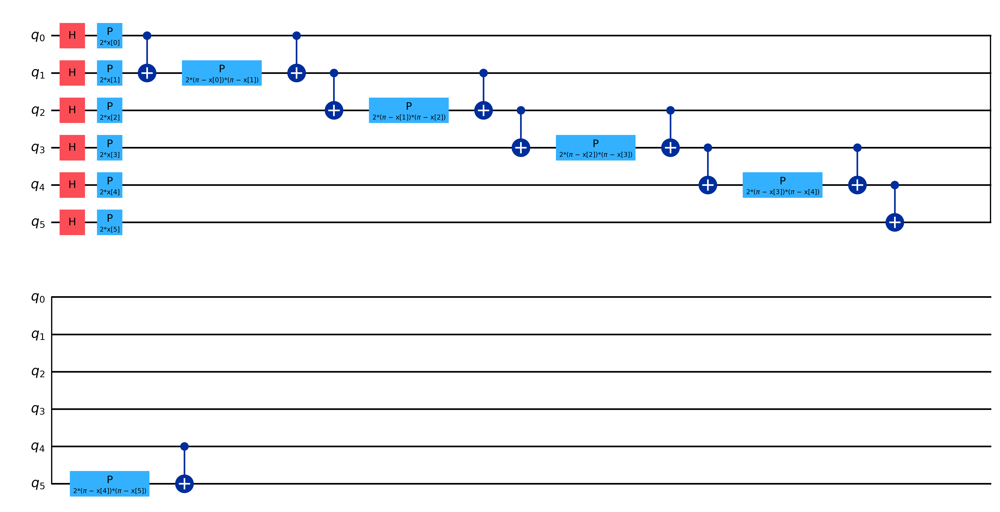

# Multi-Sensor Activity Classification — Classical vs Quantum ML

A wearable-sensor pipeline that records real physiological and motion data, classifies physical activity intensity (**rest / moderate / intense**), and benchmarks classical models against a **Quantum Support Vector Machine (QSVM)** under strict, leave-one-session-out evaluation.

> Capstone project — Al Akhawayn University, 2026. <!-- add supervisor / teammates if any -->

## Highlights

- **End-to-end hardware → ML pipeline**: live acquisition from an Arduino sensor board (serial) and a BLE heart-rate strap, fused into timestamped CSV sessions.
- **Own dataset**: 16 recorded sessions (rest, walking, stairs, squats, running) plus public datasets (UCI HAR, PAMAP2, WESAD) for early prototyping.
- **Honest evaluation**: random train/test splits scored ~100%, so every final result uses **leave-one-file-out** validation to measure generalization to unseen sessions.
- **Quantum benchmark**: QSVM (Qiskit) tuned across scalers, feature reduction, encodings (ZZ, Pauli) and entanglement topologies, compared with Random Forest and SVM.

## Results (leave-one-file-out, 3 classes)

| Model | Accuracy | F1 (macro) | Training time |
|---|---|---|---|
| SVM (RBF) | **0.750** | **0.778** | 0.2 s |
| Optimized QSVM (Pauli-ZZ, linear entanglement) | 0.742 | 0.759 | 636 s |
| Random Forest | 0.719 | 0.745 | 5.6 s |

Binary task (rest vs active): QSVM reaches **0.969** leave-one-file-out accuracy.

**Takeaway:** QSVM performance depends heavily on preprocessing and feature representation (PCA configurations performed poorly). Once tuned, it came within one point of classical SVM, but at a much higher computational cost.




## Sensors & Features

| Sensor | Source | Features (per window) |
|---|---|---|
| IMU (accelerometer + gyroscope) | Arduino board | acceleration magnitude mean, std, energy |
| Heart rate | BLE HR strap | mean, std |
| EMG | Arduino board | RMS, MAV, waveform length |
| Skin temperature | Arduino board | mean |

The QSVM uses a reduced 4-feature set: `hr_mean`, `temp_mean`, `emg_rms`, `acc_mag_mean`.

## Repository Structure

```
ml_pipeline/
├── src/
│   ├── acquisition/   # serial + BLE listeners, session recording, sensor fusion
│   └── parsers/       # per-sensor readers (IMU, ECG, EMG, pulse, temperature)
├── notebooks/         # 01–10: baselines → fusion → generalization → QSVM
├── data/raw/          # recorded sessions: rest/, moderate/, intense/
└── outputs/
    ├── plots/         # confusion matrices, comparisons, circuit diagrams
    └── logs/          # metric summaries per experiment
```

### Notebook guide

| # | Notebook | Purpose |
|---|---|---|
| 01 | IMU baseline | UCI HAR baselines (LR, RF, SVM), realistic risk labeling |
| 02 | Multi-sensor fusion | PAMAP2 (+ WESAD) 3-class fusion classifier |
| 03 | Real sensor inference | Run a trained model on live sensor CSVs |
| 05 | Baseline sensor pipeline | RF vs SVM on our own recordings |
| 06 | Generalization test | Leave-one-file-out evaluation |
| 04, 07–09 | QSVM | Binary and multiclass QSVM benchmarks |
| 10 | Quantum techniques | Scaling, encoding, entanglement and depth optimization |

## Getting Started

```bash
git clone https://github.com/linahrchrs/capstone.git
cd capstone
python -m venv venv && source venv/bin/activate
pip install -r requirements.txt
jupyter lab
```

To record a new session (Arduino on `/dev/ttyUSB0` and a BLE HR strap nearby):

```bash
python -m ml_pipeline.src.acquisition.record_session
```

Public datasets (optional, for notebooks 01–02) go under `ml_pipeline/data/raw/`: UCI HAR, PAMAP2, WESAD.

## Limitations & Next Steps

- Small dataset (16 sessions); moderate vs intense is the hardest boundary.
- QSVM runs on a simulator; runtime limits the number of training windows.
- Next: more participants, sequence models (LSTM), and on-device inference.

## Tech Stack

Python · scikit-learn · Qiskit · pandas · NumPy · Matplotlib · bleak (BLE) · pyserial · Arduino

## Author

**Lina Harcharras**. [GitHub](https://github.com/linahrchrs) <!-- add LinkedIn -->
